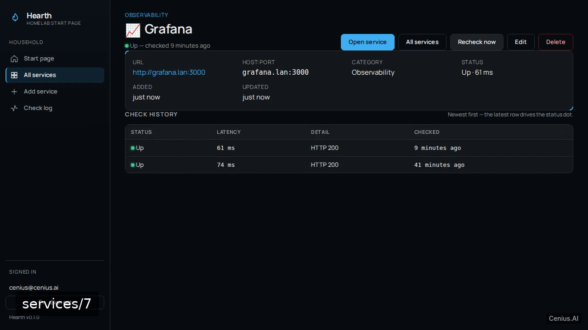
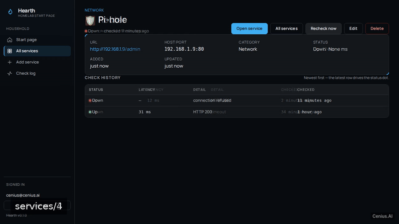
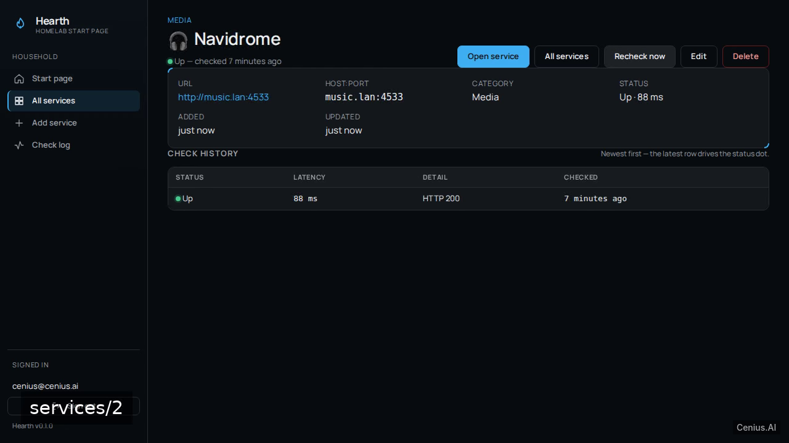
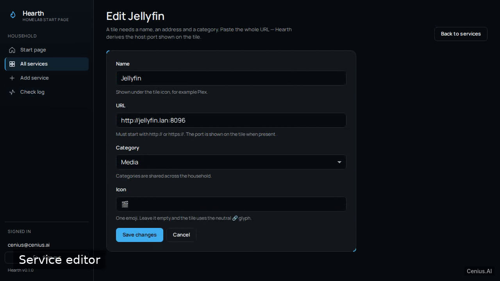
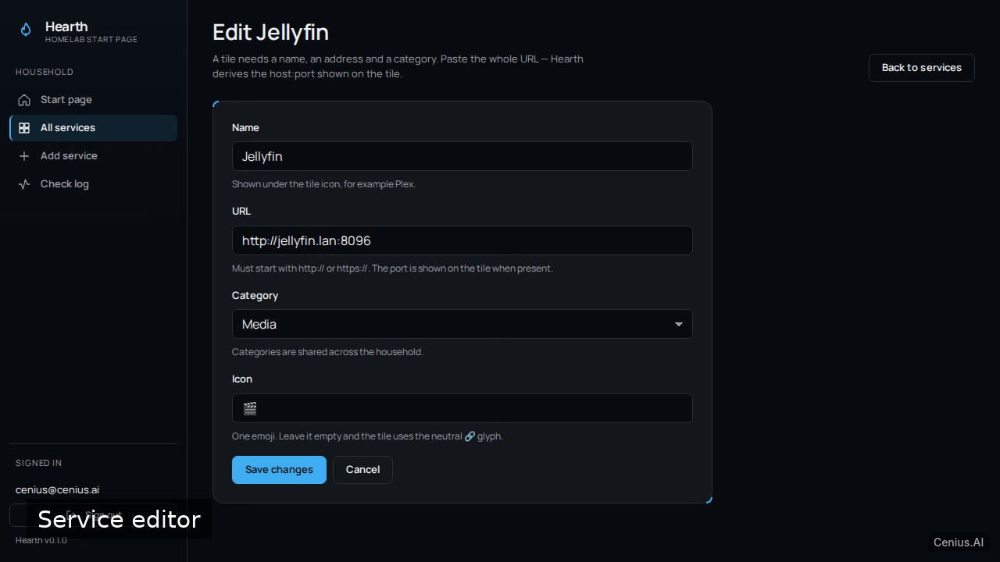

# Hearth Homelab Start Page — complete Full-stack app bookmark monitoring dashboard example app

Want to run your own monitoring dashboard without paying for SaaS? **Hearth Homelab Start Page** is a free, Apache-2.0-licensed Full-stack app project that you can clone and self-host today. Hearth is a self-hosted homelab start page built on Sanic (Python async) + SQLite: a clean, minimal dashboard of service tiles grouped by category, each tile showing a status dot derived from the last recorded server-…. Every Hearth Homelab Start Page feature — every screen, every seed record — is here. [Open Hearth Homelab Start Page on cenius.ai](https://cenius.ai/marketplace/p/hearth-homelab-start-page?ref=gh&utm_campaign=hearth-homelab-start-page-webapp) to modify it without writing code.


[](LICENSE)  [](https://cenius.ai)

[](https://cenius.ai/marketplace/p/hearth-homelab-start-page?ref=gh&utm_campaign=hearth-homelab-start-page-webapp)

> **▶ [Open & edit in cenius.ai](https://cenius.ai/marketplace/p/hearth-homelab-start-page?ref=gh&utm_campaign=hearth-homelab-start-page-webapp)** — one click to an editable workspace: describe changes in plain English, get an instant preview, one-click deploy and host. Modifications made on the platform come with full rebrand & relicense rights.

_Local clone? See [Quick start](#quick-start) below. cenius.ai is the zero-setup path._

## Demo





▶ **[Video walkthrough](https://cenius.ai/marketplace/p/hearth-homelab-start-page?ref=gh&utm_campaign=hearth-homelab-start-page-webapp)** — see the app in action on the cenius.ai project page · [MP4 file](.github/media/demo.mp4)

## Screenshots

  

## Features

- Email/password accounts and server-side sessions
- Service tiles grouped by category
- Status dots from the latest health record
- Server-side HTTP health polling
- Quick search across tiles and bookmarks
- Bookmarks row
- Drag-to-reorder layout saved per user

## Quick start

```bash
./install.sh   # installs dependencies + seeds demo data
```

See [`INSTALL.md`](INSTALL.md) for full setup and usage instructions.

## Usage guide

### Overview

This is **Hearth Homelab Start Page** — an HTTP API + web UI. This document covers the surface area you can use, with copy-pasteable examples for each entry point. For setup, see `INSTALL.md`.

### Quickstart

After completing the install steps in `INSTALL.md`:

```bash
## start the dev server (see INSTALL.md step 6)
## in another terminal:
curl http://localhost:8000/
```

### Endpoints

_No HTTP routes were auto-extracted. If the server registers routes dynamically (e.g. config-driven), document them here manually._

### Worked example

1. Boot the server (`see INSTALL.md`).
2. Hit a smoke-test endpoint:

```bash
curl -sS http://localhost:8000/
```

3. If you get a JSON / HTML response, the server is healthy. Inspect `.env` if it errors with an auth/config failure.

### Reference

#### Entry points

_No explicit entry points declared in this project's manifests._

### Next steps

- Read [INSTALL.md](./INSTALL.md) if anything in the Quickstart didn't work.
- Inspect `.env.example` for the full list of environment variables this project understands.
- See [README.md](./README.md) for the architecture diagram + feature list.

_Full guide: [`USAGE.md`](USAGE.md)_

## Architecture

No external services required: the entire bookmark monitoring dashboard runs from this Full-stack app repo (87 files). Top-level layout: `app/`, `data/`, `tests/`. One command (`./install.sh`) covers dependency setup and demo-data seeding. See [`INSTALL.md`](INSTALL.md) for complete setup instructions.

## FAQ

### What's the quickest way to self-host Hearth Homelab Start Page?

Grab the repo and run `./install.sh` — it handles packages and seed data in one go. After that, [`INSTALL.md`](INSTALL.md) walks you through starting the server. No external accounts required.

### Which technology stack does Hearth Homelab Start Page use?

Full-stack app. The full source in this repository is exactly what the app runs. Highlights include status dots from the latest health record.

### Can I build a business on Hearth Homelab Start Page?

Confirmed free for commercial use — MIT terms let you incorporate, resell, or ship it in any product. [LICENSE](LICENSE).

### Can I rebrand or white-label Hearth Homelab Start Page?

Yes. The MIT license lets you remove the original branding and ship under your own name. For a guided approach, [remix it on cenius.ai](https://cenius.ai/marketplace/p/hearth-homelab-start-page?ref=gh&utm_campaign=hearth-homelab-start-page-webapp): you get a fresh build with full rebrand and relicense rights.

### Can non-developers customise Hearth Homelab Start Page?

Yes — [load it on cenius.ai](https://cenius.ai/marketplace/p/hearth-homelab-start-page?ref=gh&utm_campaign=hearth-homelab-start-page-webapp), describe the change in plain English, and you get back a fresh build with your modification applied.

## License & rebranding

Released under the [Apache License 2.0](LICENSE) (© 2026 Cenius AI) — free for personal and commercial use. The Cenius name/logo are trademarks (see NOTICE).

**Need a customized version?** [Remix this app on cenius.ai](https://cenius.ai/marketplace/p/hearth-homelab-start-page?ref=gh&utm_campaign=hearth-homelab-start-page-webapp) — modifications made on the platform come with **full rebrand & relicense rights** over your derivative.

## Built with cenius.ai

This entire application — code, design, seeded demo data — was generated on **[cenius.ai](https://cenius.ai)** from a plain-English description.

- 🚀 [Build your own app on cenius.ai](https://cenius.ai)
- 🎛️ [Remix Hearth Homelab Start Page on the marketplace](https://cenius.ai/marketplace/p/hearth-homelab-start-page?ref=gh&utm_campaign=hearth-homelab-start-page-webapp) — open it in a workspace, prompt for changes, and ship your own version.

More open-source apps: [the Cenius-ai catalog](https://github.com/Cenius-ai) · [showcase index](https://github.com/Cenius-ai/showcase)
